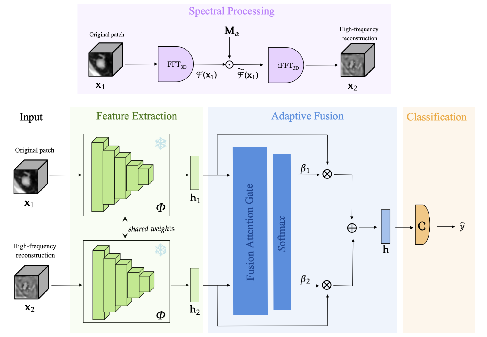

# Beyond Seen Generators: Robust Localized Deepfake Detection in CT Imaging Under Generator-Induced Distribution Shift

[Ludovica Pompilio](https://scholar.google.com/citations?user=fF5lJeUAAAAJ&hl=it&oi=ao)<sup>1</sup>, [Francesco Di Feola](https://scholar.google.com/citations?user=nzm0qagAAAAJ&hl=it&oi=ao)<sup>2</sup>, [Matteo Tortora](https://scholar.google.com/citations?user=3WpZse0AAAAJ&hl=it&oi=ao)<sup>3</sup>, [Valerio Guarrasi](https://scholar.google.com/citations?user=840UXEMAAAAJ&hl=it&oi=ao)<sup>4</sup>, [Paolo Soda](https://scholar.google.com/citations?user=E7rcYCQAAAAJ&hl=it&oi=ao)<sup>1,2</sup>

<sup>1</sup> Research Unit of Artificial Intelligence and Computer Systems, Campus Bio-Medico di Roma, Rome, Italy

<sup>2</sup> Department of Diagnostics and Intervention, Radiation Physics, Biomedical Engineering, Umeå University, Umeå, Sweden

<sup>3</sup> Department of Naval, Electrical, Electronics and Telecommunications Engineering, University of Genoa, Genoa, Italy

<sup>4</sup> UniCamillus-Saint Camillus International University of Health Sciences, Rome, Italy

# Overview



The release is organized around five stages:
1. Patch extraction
2. Spectral Processing
3. Feature Extractor
4. Multi-Representation Fusion model training
5. Multi-Representation Fusion model evaluation

## Repository Layout

The repository is organized into the following main components:

- `Dataset/`: Dataset directory
- `configs/`: JSON configuration files for training and evaluation
- `data/`: dataset metadata, split definitions, and normalization statistics
- `scripts/`: Python entry points for preprocessing, model training, and evaluation
- `src/`: project source code
  - `src/data/`: dataset handling and dataloading utilities
  - `src/models/`: model definitions
  - `src/preprocessing/`: preprocessing utilities
  - `src/training/`: training logic
  - `src/test/`: evaluation utilities
  - `src/utils/`: shared utilities
- `src_spectre/spectre/`: frozen snapshot of the [SPECTRE](https://github.com/cclaess/SPECTRE) source code used for embedding extraction. The included source code is distributed under the MIT License.

## Environment

Python 3.11 is recommended.
Install the project dependencies before running any script.

```bash
pip install -r requirements.txt
```

## Data 

| Dataset | Source | Format | Purpose |
|---|---|---|---|
| LIDC-IDRI | [link](https://www.cancerimagingarchive.net/collection/lidc-idri/) | DICOM converted to TIFF | Real CT scans |
| M3DSynth | [link](https://www.grip.unina.it/download/prog/M3Dsynth/) | TIFF | Manipulated CT scans |

To convert the LIDC-IDRI DICOM scans to TIFF, first run `./scripts/convert_Dicom2Tiff.py`.

```bash
python scripts/convert_Dicom2Tiff.py \
  --lidc-root "<path_to_lidc_idri_dicom_root>" \
  --output-dir "./Dataset/M3DSynth/"
```

Expected local layout:
```text
./Dataset/
  M3DSynth/
    real/
      scan/
        <orig_id>/
    cycle/
      scan/
        <img_id>/
      label/
        <img_id>/
    diffusion/
      scan/
        <img_id>/
      label/
        <img_id>/
    pix2pix/
      scan/
        <img_id>/
      label/
        <img_id>/
```

### 1. Patch extraction

This step extracts 3D CT patches from the real and manipulated scans, then stores them as `.npy` volumes together with one metadata CSV per sample.

```bash
python scripts/extract_CTpatches.py \
  --data-root-real "./Dataset/M3DSynth" \
  --data-root-fake "./Dataset/M3DSynth" \
  --data-csv "./data/data.csv" \
  --sets-csv "./data/sets.csv" \
  --spacing-csv "./data/LIDC.csv" \
  --mods "real,cycle,diffusion,pix2pix" \
  --ty "inj" \
  --set-name "train,valid,test" \
  --lidc-stats-csv "./data/LIDCIDRI_scan_stats.csv" \
  --sample-format "npy" \
  --output-dir "./img_patch" \
  --batch-size 8
```

Output layout:

```text
./img_patch/
  train/
    inj/
      real/
        samples/
        metadata/
      cycle/
        samples/
        metadata/
      diffusion/
        samples/
        metadata/
      pix2pix/
        samples/
        metadata/
  valid/...
  test/...
```


### 2. Spectral Processing

This step applies 3D Fourier high-pass filtering to the patches extracted in step 1 and reconstructs the high-frequency view with the inverse FFT. It saves each patch as a `.npy` volume, together with a metadata CSV.

```bash
python scripts/spectral_processing.py \
  --data-root "./img_patch" \
  --mods "real,cycle,diffusion,pix2pix" \
  --ty "inj" \
  --set-name "train,valid,test" \
  --sample-format "npy" \
  --batch-size 8 \
  --output-dir "./ifft_patch" \
  --cutoff 0.75
```

Output layout:

```text
./ifft_patch/
  train/
    inj/
      real/
        samples/
        metadata/
      cycle/
        samples/
        metadata/
      diffusion/
        samples/
        metadata/
      pix2pix/
        samples/
        metadata/
  valid/...
  test/...
```

### 3. Feature Extractor

This step extracts embeddings from image patches or ifft patches using `scripts/extract_emb.py`.
The commands below are examples. Before running them, replace `<split>`, with the value (`train`, `valid`, `test_id`, or `test_ood`) that match the split you want to process. 

Example: extract embeddings from image patches.

```bash
python scripts/extract_emb.py \
  --experiments "OOD-Arch-RCDvsRP" "OOD-Arch-RPDvsRC" "OOD-Paradigm-RCPvsRD" "OOD-Paradigm-RCvsRD" "OOD-Paradigm-RDvsRC" "OOD-Paradigm-RDvsRCP" "OOD-Paradigm-RDvsRP" OOD-Paradigm-RPvsRD \
  --splits-root "./data/splits" \
  --data-root "./img_patch" \
  --ty "inj" \
  --set-name "<split>" \
  --grid-size "2,2,2" \
  --output-dir "./embeddings/embs_img" \
  --batch-size 8 \
  --source-representation img
```

Example: extract embeddings from ifft patches.

```bash
python scripts/extract_emb.py \
  --experiments "OOD-Arch-RCDvsRP" "OOD-Arch-RPDvsRC" "OOD-Paradigm-RCPvsRD" "OOD-Paradigm-RCvsRD" "OOD-Paradigm-RDvsRC" "OOD-Paradigm-RDvsRCP" "OOD-Paradigm-RDvsRP" OOD-Paradigm-RPvsRD  \
  --splits-root "./data/splits" \
  --data-root "./ifft_patch" \
  --ty "inj" \
  --set-name "<split>" \
  --grid-size "2,2,2" \
  --output-dir "./embeddings/embs_ifft" \
  --batch-size 8 \
  --source-representation ifft \
  --norm_stats_csv "./data/ifft_train_stats_alpha075.csv"
```
Notes:
`ifft_train_stats_alpha075.csv` is provided as an example of the normalization statistics file used by `--norm_stats_csv`. It is obtained by merging the per-sample metadata CSV files produced in `./ifft_patch/train/` for the `real`, `cycle`, `diffusion`, and `pix2pix` samples. The resulting CSV must contain at least the `min` and `max` values for each sample to support IFFT normalization.

Output layout:

```text
./embeddings/
  embs_img/
    <experiment_name>/
      train/
        <ty>/
          <mod>/
            samples/
            metadata/
      valid/...
      test_id/...
      test_ood/...
  embs_ifft/
    <experiment_name>/
      train/...
      valid/...
      test_id/...
      test_ood/...
```

### 4. Multi-Representation Fusion model training
This step trains the fusion model (Soft Attention and Classification Head) using the embeddings extracted in step 3. 
The commands below are examples. Before running them, replace `<experiment_name>` with the experiment name listed in `./data/splits/experiments.json`, for example `OOD-Arch-RCDvsRP`.

Example:
```bash
python scripts/train_SoftAttentionFusionModel.py \
  --config_base "./configs/training_base.json" \
  --config "./configs/train_SoftAttentionFusionModel.json" \
  --experiment_name "<experiment_name>"
```
#### Notes

Configuration priority is:
- command-line arguments override values from the configuration files
- values not provided explicitly fall back to the parser defaults


### 5. Multi-Representation Fusion model evaluation

This step evaluates the fusion model (Soft Attention and Classification Head) trained in step 4.  It uses the `test_id` split embeddings for in-distribution evaluation, and the `test_ood` split embeddings for out-of-distribution evaluation.

The commands below are examples. Before running them, replace `<experiment_name>` with the experiment name listed in `./data/splits/experiments.json`, for example `OOD-Arch-RCDvsRP`.

```bash
python scripts/test_SoftAttentionFusionModel.py \
  --config_base "./configs/test_base.json" \
  --config "./configs/test_SoftAttentionFusionModel.json" \
  --experiment_name "<experiment_name>"
```

#### Notes

Configuration priority is:
- command-line arguments override values from the configuration files
- values not provided explicitly fall back to the parser defaults


## Citations

## Contact
Ludovica Pompilio - ludovica.pompilio@unicampus.it
